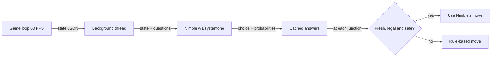

# Pac-Man with Nimble

A Pygame Pac-Man where the four ghosts (and optionally Pac-Man himself) are steered by
**Nimble**, a 9B decision model served by Ollama through its `/v1/systemone` endpoint.
Nimble does not chat: it receives a JSON game state plus a set of multiple-choice
questions, and returns one choice per question together with a probability for every option.

Every decision is safety-checked by the game, and a classic rule-based AI takes over
whenever Nimble is off, slow, or suggests an illegal move.

## Requirements

- Python 3.10+ with `pygame` (`pip install pygame`)
- [Ollama](https://ollama.com) running locally (`ollama serve`)
- A Nimble model pulled, by default `nimble-v3:9b-q4_K_M`
  (any Nimble tag works via `--model`, e.g. `ollama pull nimble` then `--model nimble:latest`)

## How to run

```bash
cd python_games/pacman

python game.py                          # you play Pac-Man, Nimble drives the ghosts (default)
python game.py --mode auto              # Pac-Man plays itself with Nimble; ghosts use Nimble
python game.py --mode auto --pac-brain rules   # Pac-Man uses the rule-based autopilot; ghosts use Nimble
python game.py --mode rules             # you play, ghosts use rules only (no Ollama needed)
```

| Mode | Pac-Man | Ghosts | Needs Ollama |
|---|---|---|---|
| `--mode nimble` (default) | You | Nimble, rules as fallback | yes |
| `--mode auto` | Nimble autopilot (`--pac-brain nimble`) or rules (`--pac-brain rules`) | Nimble, rules as fallback | yes |
| `--mode rules` | You | Rules | no |

When Nimble is enabled, the game waits on the **"WAITING FOR NIMBLE..."** screen until
Nimble answers a small test question (this also loads the model into memory). Pac-Man and
the ghosts only start moving after that. Press **N** to skip the wait and play with rules.
The same wait applies to the "READY!" pause after each death and after a restart.

In auto mode the game restarts by itself 3 seconds after a win or game over.

### Other options

| Flag | Default | Meaning |
|---|---|---|
| `--model` | `nimble-v3:9b-q4_K_M` | Ollama model name |
| `--url` | `http://127.0.0.1:11434/v1/systemone` | Nimble endpoint |
| `--interval` | `0.15` | Minimum seconds between Nimble requests |
| `--stale` | `1.5` | Ignore Nimble answers older than this many seconds |
| `--timeout` | `30` | Request timeout in seconds |
| `--lives` | `3` | Starting lives |
| `--print-state` | off | Print every JSON state sent to Nimble |

### In-game keys

| Key | Action |
|---|---|
| Arrows / WASD | Move Pac-Man (in auto mode this takes over control) |
| A | Toggle autopilot |
| N | Toggle Nimble on/off (off means pure rules) |
| C | Show the tile coordinate overlay |
| R | Restart |
| Esc | Quit |

The side panel shows Nimble's status and latency. For Pac-Man and each ghost it shows
the tile, Nimble's latest choice with its probability, and who actually made the last
move (`used: nimble`, `rules`, `forced` or `human`).

## Game rules

- The maze is 19 x 21 tiles of 24 px. Pellets are worth **10** points, power pellets **50**.
- A power pellet makes every active ghost **frightened** for 7 seconds. Frightened ghosts
  turn around immediately, move at half speed and can be eaten for **200, 400, 800, 1600**
  points (the bonus doubles for each ghost eaten during one power pellet).
- An eaten ghost turns into eyes, rushes back to the ghost house at double speed and comes
  out again 2 seconds later.
- Touching a ghost that is not frightened costs a life. You start with 3 lives.
  Eat every pellet to win.
- Ghosts leave the house one by one: Blinky starts outside, then Pinky after 3 s,
  Inky after 6 s and Clyde after 9 s.
- The tunnel on the middle row wraps from the left edge to the right edge.

## How decisions are made

A background thread asks Nimble about every 0.15 s, so the 60 FPS game loop never waits
for the model. Each request contains the full game state and one question per character
that needs a decision:



### State sent to Nimble

```json
{
  "maze": {"cols": 19, "rows": 21, "tile_px": 24, "origin_px": [0, 44]},
  "frightened_seconds_left": 0.0,
  "pacman": {
    "tile": [9, 15], "pixel": [228, 416], "direction": "left", "facing": "left",
    "can_move": {"left": true, "right": true, "up": false, "down": false},
    "tile_4_ahead": [5, 15]
  },
  "ghosts": {
    "blinky": {
      "tile": [9, 7], "pixel": [228, 224], "direction": "left", "state": "normal",
      "can_move": {"left": true, "right": true, "up": false, "down": false},
      "reverse_direction": "right",
      "delta_to_pacman_tiles": {"dx": 0, "dy": 8},
      "distance_to_pacman_tiles": 8.0
    }
  },
  "pellets_left": 150,
  "power_pellet_tiles": [[1, 2], [17, 2], [1, 15], [17, 15]]
}
```

A ghost's `state` is one of `house`, `leaving`, `normal`, `frightened` or `eaten`.
Run with `--print-state` to see the real states.

### Questions and answers

Every question is a `choice` question with the same four options:

| Option | Criterion |
|---|---|
| `left` | Move left (col-1). Only if can_move.left is true. |
| `right` | Move right (col+1). Only if can_move.right is true. |
| `up` | Move up (row-1). Only if can_move.up is true. |
| `down` | Move down (row+1). Only if can_move.down is true. |

Questions are named `blinky_move`, `pinky_move`, `inky_move`, `clyde_move` and, in auto
mode with the Nimble brain, `pacman_move`. Only ghosts that are roaming freely
(state `normal`) get a question. Nimble answers like this:

```json
{"answers": {"blinky_move": {"choice": "down",
             "probabilities": {"left": 0.04, "right": 0.03, "up": 0.01, "down": 0.92}}}}
```

The game uses `choice`, which is the highest-probability option. If `choice` is missing
or invalid, the game uses the option with the highest probability itself. The probability
of the chosen move appears in the side panel. Answers older than `--stale` seconds are
thrown away.

## Ghost decisions

### Nimble prompts

Each ghost's question instructions are its personality followed by a set of common rules.

| Ghost | Personality prompt |
|---|---|
| Blinky (red) | "You are Blinky, the red ghost. Chase Pac-Man directly: pick the move that closes the distance to his current tile fastest." |
| Pinky (pink) | "You are Pinky, the pink ghost. Ambush Pac-Man: head for the tile 4 tiles ahead of the direction he is facing, not his current tile." |
| Inky (cyan) | "You are Inky, the cyan ghost. Flank Pac-Man: approach from the opposite side to Blinky so Pac-Man gets pinched between you and Blinky." |
| Clyde (orange) | "You are Clyde, the orange ghost. Chase Pac-Man while you are more than 8 tiles away, but retreat toward the bottom-left corner (tile col 1,row 19) when closer than 8 tiles." |

Common rules added to every ghost:

> Coordinates are maze tiles (col,row): col grows to the right, row grows downward.
> Your own data is in state.ghosts.\<your name\>. Choose ONLY a direction whose can_move
> flag is true, and avoid reversing your current direction unless forced.
> If your state is 'frightened', do the opposite: maximise distance from Pac-Man.

### When Nimble's answer is used

A ghost only decides when it reaches the centre of a tile:

1. **House / leaving / eaten:** no question is asked. A ghost in the house waits for its
   release time, a leaving ghost takes the shortest path to the door, and an eaten ghost
   takes the shortest path home.
2. **Legal moves:** these are the open directions minus turning back, which a ghost is
   only allowed to do in a dead end.
3. **Only one legal move:** the ghost takes it (`used: forced`).
4. **Nimble:** if Nimble is on and has a fresh answer that is one of the legal moves,
   the ghost uses it (`used: nimble`).
5. **Otherwise rules:** the ghost uses the rule-based move (`used: rules`).

### Rule-based ghosts (fallback)

The same idea as the arcade game: each ghost has a target tile and, among its legal
moves, picks the one whose next tile is closest to that target in straight-line distance.
Ties are broken in the order up, left, down, right.

| Ghost | Target tile |
|---|---|
| Blinky | Pac-Man's tile |
| Pinky | 4 tiles ahead of the way Pac-Man is facing |
| Inky | Take the tile 2 ahead of Pac-Man and double the vector from Blinky to it (pincer) |
| Clyde | Pac-Man's tile when more than 8 tiles away, otherwise the corner (1, 19) |
| Any frightened ghost | No target: picks the move that ends **farthest** from Pac-Man |

## Pac-Man decisions (auto mode)

In manual modes you steer Pac-Man yourself. A key press is buffered and applied at the
next tile where that turn is possible. In auto mode Pac-Man decides at every tile centre.

### Nimble prompt (`--pac-brain nimble`)

> You are Pac-Man, controlled by an autopilot. Eat every pellet and stay alive. Never move
> toward a ghost whose state is not 'frightened' if it is within 3 tiles; flee along the
> route with the most free space instead. If a ghost is 'frightened' and close, chase it.
> Otherwise head for the nearest pellet, preferring a power pellet when ghosts are near.
> Coordinates are maze tiles (col,row): col grows right, row grows downward.
> Your data is state.pacman. Choose ONLY a direction whose can_move flag is true.

### Safety check on Nimble's move

The game measures how far each tile is from the nearest dangerous ghost (normal or
leaving, and not frightened), counting steps through the maze rather than straight-line
distance. Nimble's move is used (`used: nimble`) only if it is:

- fresh (younger than `--stale` seconds),
- an open direction, and
- leading to a tile that is **at least 3 steps** away from every dangerous ghost.

If any check fails, the rule-based autopilot makes the move (`used: rules`).

### Rule-based autopilot (`--pac-brain rules`, and the fallback)

The rules are tried in this order:

1. **Hunt:** if more than 2 seconds of fright time remain, take the shortest path
   to the nearest frightened ghost. The path must not pass within 2 steps of a dangerous
   ghost, and the first step must not be within 2 steps of one either.
2. **Eat:** otherwise take the shortest safe path to the nearest pellet or power pellet,
   again avoiding tiles within 2 steps of a dangerous ghost.
3. **Escape:** if no safe path exists, Pac-Man is cornered and moves to the neighbouring
   tile that is farthest from the nearest dangerous ghost.

## How well it plays

Benchmark: 5 full games in `--mode auto --pac-brain nimble`, with Nimble driving both Pac-Man
and the ghosts, on a laptop with an 8 GB RTX 5050 (`nimble-v3:9b-q4_K_M`).

| Game | Result | Score | Pellets eaten | Length |
|---|---|---|---|---|
| 1 | Won | 1860 | 150 / 150 | 103 s |
| 2 | Won | 2260 | 150 / 150 | 95 s |
| 3 | Game over | 1590 | 111 / 150 | 69 s |
| 4 | Game over | 750 | 67 / 150 | 39 s |
| 5 | Game over | 1740 | 122 / 150 | 70 s |

- **Win rate:** 2 of 5 games (40%). Average score 1640, and on average 80% of the maze cleared.
- **Pac-Man:** Nimble's move was used for 31% of Pac-Man's decisions, and the rule-based
  autopilot made the rest.
- **Ghosts:** at junctions where a ghost had a real choice, Nimble decided 23% of the time.
- **Why the fallback rate is high:** Nimble took about 2.5 s per request on this GPU, longer
  than the 1.5 s freshness limit, so many answers arrived too late to use. Most of the
  remaining fallbacks are the safety check rejecting a Pac-Man move that led toward a ghost.

## Roadmap

- **Learn from its own games:** record every state, Nimble's choice and probabilities, and
  the outcome (pellet eaten, ghost eaten, life lost, win). Then fine-tune the decision model
  on the moves that led to wins and away from the ones that cost lives, and repeat over many
  games so the win rate rises with each round.
- **Track progress:** win rate, average score and how often the safety check has to
  overrule Nimble, measured after every training round.
- **Faster decisions:** a smaller quantization or a GPU with more memory, so answers arrive
  inside the freshness limit and Nimble makes more of the moves itself.

## Decision summary

| | Nimble decides | Game checks before using it | Fallback rules |
|---|---|---|---|
| Ghosts | Personality prompt + common rules | Fresh, legal, no turning back, only at junctions | Arcade-style target tiles; flee when frightened |
| Pac-Man (auto) | Pac-Man prompt | Fresh, open direction, at least 3 steps from a dangerous ghost | Hunt frightened ghosts, then nearest safe pellet, then escape |
